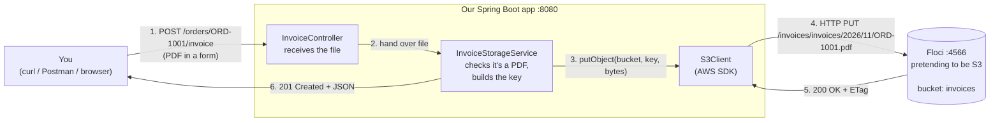
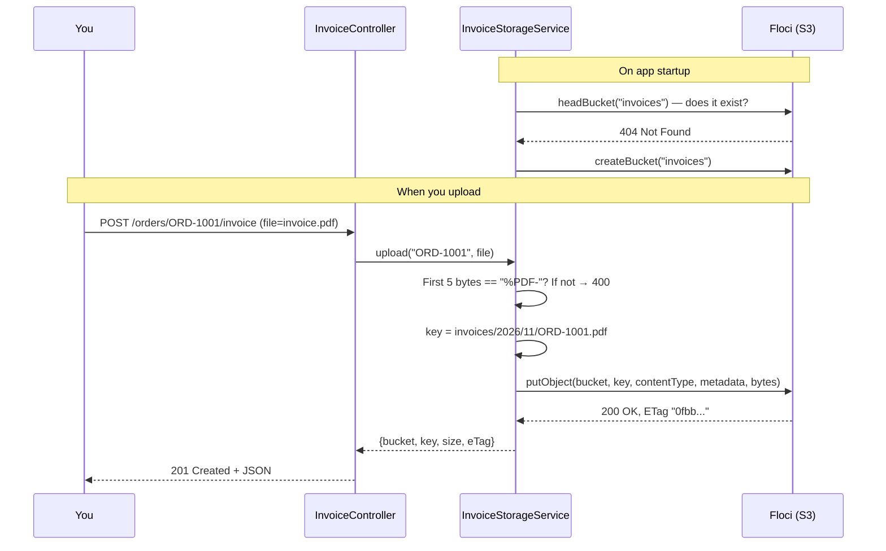

# S3 Basics: What It Is and How Our Invoice Upload Works

## 1. What is S3?

**S3 (Simple Storage Service)** is AWS's file storage. Think of it as a giant hard drive on the internet that you reach over HTTP.

- You don't manage disks or servers. You upload a file, and AWS keeps it safe (copies it across several data centres).
- Each file can be up to 5 TB, and you can store as many as you like.
- You pay for what you store and what you download.

**What it's used for:** invoices, profile pictures, videos, backups, log files, static websites, data for analytics. In short, anything that is a *file* and not a *row in a database*.

**What it's NOT:** a database (you can't query "invoices where total > 100"), and not a normal file system (no real folders, no editing part of a file in place).

---

## 2. The three words you need

| Term | What it means | In our project |
|------|---------------|----------------|
| **Bucket** | A top-level container for files. On real AWS its name must be unique worldwide. | `invoices` |
| **Object** | One file plus its info (size, type, metadata). | the PDF |
| **Key** | The object's full name / path inside the bucket. | `invoices/2026/11/ORD-1001.pdf` |

So the full address of a file is **bucket + key**:

```
s3://invoices/invoices/2026/11/ORD-1001.pdf
     └──┬───┘ └────────────┬──────────────┘
     bucket              key
```

### "Folders" are fake

S3 has **no real folders**. `invoices/2026/11/ORD-1001.pdf` is just one long string. The AWS console *shows* the slashes as folders to be friendly, but under the hood it's a flat list of keys.

That's why we design keys carefully: S3 can quickly list "all keys that start with `invoices/2026/11/`", which gives us **all November invoices**. That's called a **prefix** search.

### What else is stored with an object

```
Object: invoices/2026/11/ORD-1001.pdf
├── Body (the bytes)    → the actual PDF
├── Content-Type        → application/pdf   (so browsers know to open it as a PDF)
├── Content-Length      → 879               (size in bytes)
├── ETag                → "0fbbb6ea..."     (a fingerprint of the content, usually its MD5)
└── User metadata       → order-id = ORD-1001, original-filename = invoice-ORD-1001.pdf
```

---

## 3. What is Floci and why are we using it?

Real S3 needs an AWS account, a credit card, and costs money if you make mistakes.

**Floci** is an **emulator**: a program running in Docker on your laptop that *pretends to be AWS*. It speaks exactly the same HTTP API, so the same Java code works against both. The only difference is **where we send the requests**:

| | Real AWS | Floci (our lab) |
|---|---|---|
| Address | `https://s3.us-east-1.amazonaws.com` | `http://localhost:4566` |
| Credentials | Real access keys / IAM role | Anything works (`test` / `test`) |
| Cost | Money | Free |

---

## 4. The big picture: how an upload flows



If the diagram doesn't render in your editor, here's the same thing in text:

```
 ┌──────────┐  1. POST PDF   ┌─────────────────────────────────────┐  4. HTTP PUT   ┌────────────────┐
 │   You    │ ─────────────▶ │  Spring Boot app (port 8080)        │ ─────────────▶ │ Floci (4566)   │
 │  (curl)  │                │                                     │                │ = fake S3      │
 │          │ ◀───────────── │  Controller → Service → S3Client    │ ◀───────────── │                │
 └──────────┘ 6. 201 + JSON  └─────────────────────────────────────┘  5. OK + ETag  │ bucket:invoices│
                                                                                    └────────────────┘
```

### Step by step, as a timeline



**Important:** you never talk to S3 directly. Your app sits in the middle and decides *what* gets stored and *under which name*. (Later, with **presigned URLs**, we'll let clients upload straight to S3, with the app only handing out a temporary permission slip.)

---

## 5. What AWS configuration is needed

To talk to S3 the SDK needs to know 4 things. All are in `src/main/resources/application.properties`:

```properties
aws.region=us-east-1                 # 1. WHICH AWS region
aws.endpoint=http://localhost:4566   # 2. WHERE to send requests (Floci, not real AWS)
aws.access-key=test                  # 3. WHO you are (credentials)
aws.secret-key=test                  #    Floci accepts anything
aws.s3.invoice-bucket=invoices       # 4. WHICH bucket our app uses
```

| Setting | Why it's needed | On real AWS |
|---------|-----------------|-------------|
| **Region** | AWS has data centres worldwide (`us-east-1`, `ap-south-1` Mumbai, ...). Every bucket lives in one region. | Choose one near your users |
| **Endpoint** | The URL to send requests to. | **Remove it.** The SDK works it out from the region |
| **Credentials** | Every AWS request is signed with your keys so AWS knows who you are and what you're allowed to do. | **Never hard-code them.** Use an IAM role (on EC2/ECS) or `aws configure` locally |
| **Bucket name** | Our own app setting, not an AWS one. | Must be globally unique, e.g. `flocilab-invoices-prod` |

### The S3 client in code (`config/AwsConfig.java`)

```java
S3Client.builder()
    .region(Region.of(region))                       // 1. region
    .endpointOverride(URI.create(endpoint))          // 2. send to Floci instead of AWS
    .credentialsProvider(StaticCredentialsProvider   // 3. dummy credentials
        .create(AwsBasicCredentials.create(accessKey, secretKey)))
    .forcePathStyle(true)                            // see below
    .build();
```

**What is `forcePathStyle(true)`?** There are two ways to put the bucket name in a URL:

```
Virtual-hosted style (AWS default):  http://invoices.localhost:4566/invoices/2026/11/ORD-1001.pdf
Path style (what we force):          http://localhost:4566/invoices/invoices/2026/11/ORD-1001.pdf
```

The first one needs DNS for `invoices.localhost`, which doesn't work on your laptop. So for Floci we put the bucket in the path. On real AWS you'd drop this line.

### The AWS CLI config

The `aws` command-line tool needs the same info. You set it once with `aws configure` (stored in `~/.aws/credentials` and `~/.aws/config`):

```
AWS Access Key ID:     test
AWS Secret Access Key: test
Default region name:   us-east-1
Default output format: json
```

Then add `--endpoint-url http://localhost:4566` to every command so it goes to Floci.

---

## 6. Where everything is in our code

```
src/main/java/com/flocilab/orders/
├── config/
│   ├── AwsConfig.java             → builds the S3Client (region, endpoint, credentials)
│   └── BucketInitializer.java     → on startup: create "invoices" bucket if missing
└── invoice/
    ├── InvoiceController.java     → POST /orders/{orderId}/invoice
    ├── InvoiceStorageService.java → checks it's a PDF, builds the key, calls putObject
    ├── InvoiceUploadResponse.java → the JSON we return
    └── InvalidInvoiceException.java → turned into a 400 response
samples/
└── make_invoice.py                → generates fake invoice PDFs to test with
```

---

## 7. Try it yourself

```bash
# 0. Floci running?  (should print something, not "connection refused")
curl http://localhost:4566

# 1. Start the app (from floci-aws-lab/)
./mvnw spring-boot:run

# 2. Make a fake invoice and upload it (from samples/)
python make_invoice.py ORD-2002
curl -F "file=@invoice-ORD-2002.pdf" http://localhost:8080/orders/ORD-2002/invoice

# 3. See what's in the bucket
aws --endpoint-url http://localhost:4566 s3 ls s3://invoices --recursive

# 4. Look at one object's details (content type, metadata)
aws --endpoint-url http://localhost:4566 s3api head-object --bucket invoices --key invoices/2026/11/ORD-2002.pdf

# 5. Download it back and open it
aws --endpoint-url http://localhost:4566 s3 cp s3://invoices/invoices/2026/11/ORD-2002.pdf downloaded.pdf
```

---

## 8. Cheat sheet: S3 operations

| Operation | SDK method | CLI | What it does | Done? |
|-----------|-----------|-----|--------------|-------|
| Create bucket | `createBucket` | `s3 mb s3://name` | Make a new bucket | ✅ |
| Check bucket | `headBucket` | `s3api head-bucket` | Does it exist / can I access it? | ✅ |
| Upload | `putObject` | `s3 cp file s3://...` | Store a file under a key | ✅ |
| Get info | `headObject` | `s3api head-object` | Size, type, metadata, without downloading | ⬜ |
| Download | `getObject` | `s3 cp s3://... file` | Fetch the bytes | ⬜ |
| List | `listObjectsV2` | `s3 ls` | List keys, optionally by prefix | ⬜ |
| Delete | `deleteObject` | `s3 rm` | Remove an object | ⬜ |
| Presigned URL | `S3Presigner` | `s3 presign` | Temporary link so others can download/upload without credentials | ⬜ |

## 9. Common interview questions

- **S3 vs a database?** S3 holds files (blobs) cheaply and at huge scale. A database holds structured data you query. Typical pattern: PDF in S3, and the S3 key saved in the order's DB row.
- **Is S3 a file system?** No. It's flat key → object storage. "Folders" are just key prefixes.
- **What happens if I upload to the same key twice?** The new file replaces the old one, unless **versioning** is enabled on the bucket.
- **How do you let a user download a private file without making the bucket public?** A **presigned URL**: a link signed with your credentials that expires after N minutes.
- **How do you handle large files?** **Multipart upload**: split into parts, upload in parallel, retry only failed parts. Recommended above ~100 MB.
